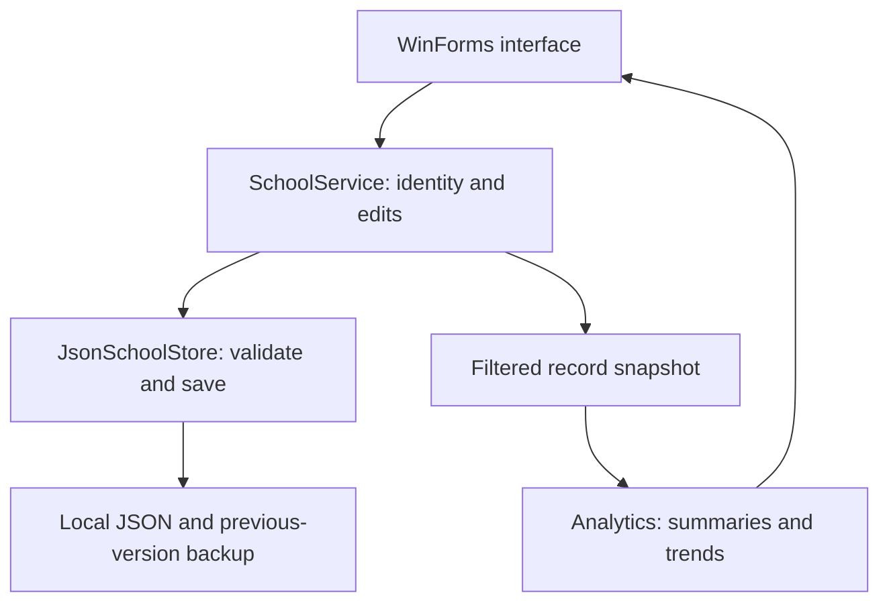

# Design and data relationships

The application has a presentation project and a separate Core project. The UI authenticates through SchoolService and reads a filtered snapshot. Teacher mutations pass through the service, are validated as a candidate copy, and are persisted before becoming live. This avoids coupling calculations to controls or disk access.

## Record relationships

| Relationship | Implementation |
|---|---|
| Student → attendance | StudentId plus school date identifies one record. |
| Term → calendar | Explicit SchoolDays list controls valid attendance dates. |
| Term → assessment | Assessment holds TermId, date, subject and maximum mark. |
| Student ↔ assessment | MarkRecord joins them; a missing/null mark is unmarked. |
| Student ↔ activity | Membership joins the student and sport/club. |
| Activity → session | Dated shared practices or meetings. One session per activity per date. |
| Student ↔ session | Participation records attended/missed; no entry means unrecorded. |
| Student → achievement | Dated description linked to an activity and an enrolled student. |
| Account → student | Student account references exactly one student; teacher account has no StudentId. |

The model uses composition: a Student is not a subtype of Account or Activity. Role differences are represented by an enum and explicit permission checks; inheritance is not forced into the design. Classes/records and service boundaries demonstrate abstraction and encapsulation, while LINQ calculations provide functional-style transformations without making the application a purely functional program.

## Reporting design choices

The as-of control allows repeatable historical reports from dated records. Assessment charts are per subject; every point has a date, title and normalized mark. Weekly attendance and activity charts show percentage of recorded observations and disclose coverage. Term summary figures are recomputed from source records, avoiding double-counted or stale stored summaries.

No weighted sports/academic composite is calculated. Displaying both measures preserves their meaning and lets the user inspect changes. Award descriptions give context rather than assigning unsupported numerical weights.

## Local boundaries

The teacher's authority covers the whole fictional demonstration class. A student receives only their own student-specific data from SchoolService, and teacher writes are checked in the service independently of button visibility. Global assessment and activity schedules are shared metadata. There is no network service or institutional authentication. A person who can edit the local file can change its contents, including accounts; role checks do not make that file tamper-proof.

Asynchronous file I/O helps avoid blocking the interface during writes. A SemaphoreSlim serializes writes; it is not a demonstration of parallel analytics. A named Windows mutex prevents a second instance for the same user. This scope has no reason to parallelize small calculations.
